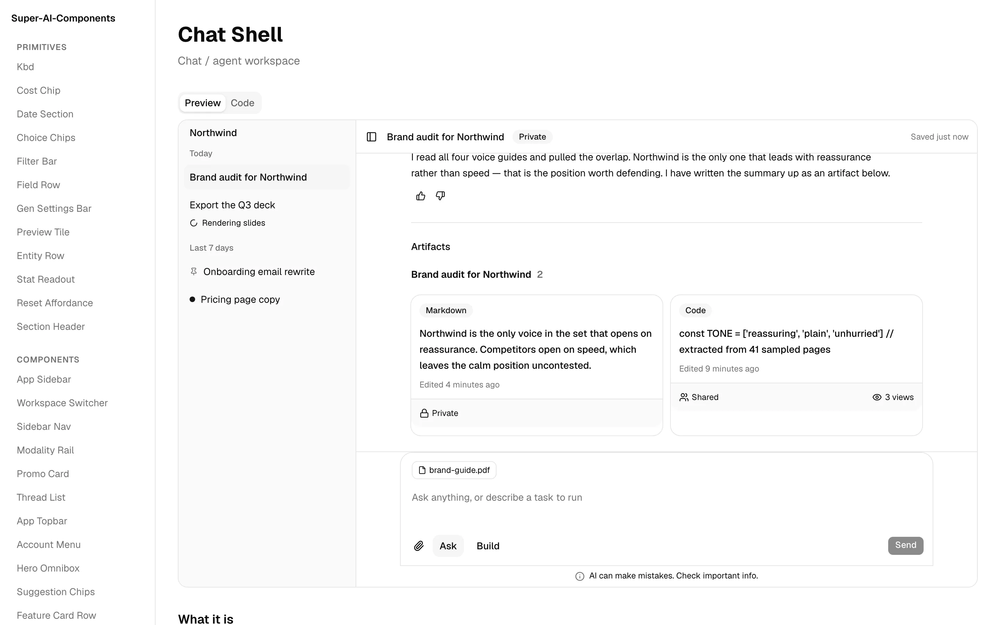
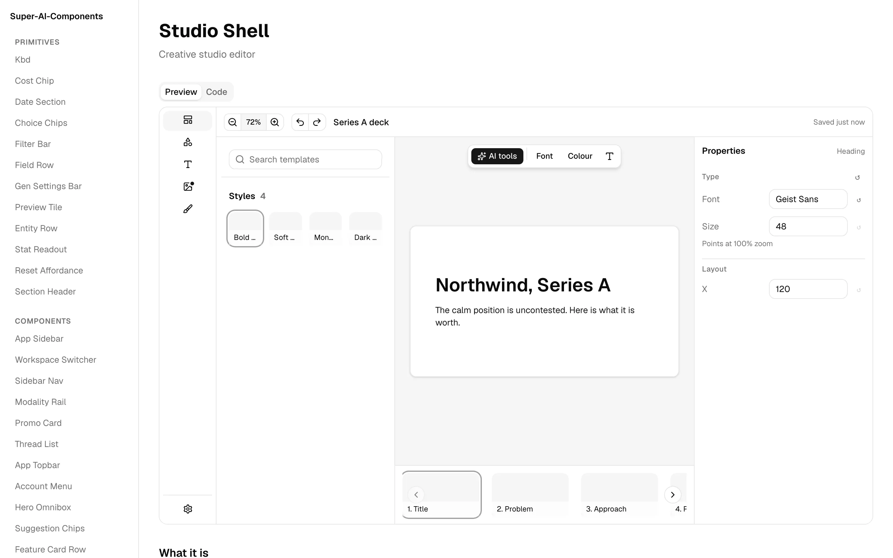

# Super-AI-Components

The missing half of [AI Elements](https://elements.ai-sdk.dev): a shadcn registry of components
for AI applications: app shells, creative studios, feedback loops, observability and monetization
UI. AI Elements gives you the conversation; this gives you the application.



**Live:** https://super-ai-components.vercel.app

## Install (shadcn apps on Base UI)

Requires a shadcn app on Base UI (style base-nova). Radix-based styles such as new-york fail to typecheck: these components use Base UI's render prop and callbacks like onOpenChangeComplete, which Radix primitives do not have.

```bash
npx shadcn@latest add https://super-ai-components.vercel.app/r/thread-list.json
```

**The catalog is complete: 121 of 121 items shipped**, across families A–R: primitives, chrome,
composers, generation, results, timeline, tools, library, documents, guidance, account, trust,
observability, thirteen page-level blocks, family P's data view and detail-view shell, two presentational chrome items (family Q, from Geist), and family R's widget, widget grid and view frame for chats that answer in components. Eleven further items are cut on the
record (family G and O5, per D9) and are not coming back. Plus five `registry:lib` contracts, `generated-chat` among them: the engine behind [`/generated-chat`](https://super-ai-components.vercel.app/generated-chat).
Full catalog: `docs/design-system/` (see below).

**Marketing wave 1** adds a second registry namespace: 15 landing-page mini-components
(`bento-grid`, `marquee`, `terminal`, `hero-video-dialog`, `number-ticker`, `text-animate`,
`typing-animation`, `aurora-text`, `rainbow-button`, `ripple-button`, `pulsating-button`,
`border-beam`, `orbiting-circles`, `dot-pattern`, `confetti`) rebuilt to the same standards:
shadcn CSS variables for chrome, tunable `--marketing-*` custom properties for signature
palettes, `prefers-reduced-motion` honored by every animated component, and one test file each.
They install the same way (`/r/<name>.json`) and land in `components/marketing/`, with their
keyframes and palette variables shipped into the consumer's stylesheet by the registry.

## Develop

```bash
pnpm install
pnpm dev              # docs site (apps/docs) and Storybook on :6007
pnpm lint
pnpm typecheck
pnpm test             # vitest behavior tests
pnpm check:tokens     # token-contract lint (shadcn CSS variables only)
pnpm check:contract   # manifest, citations and dependency reconciliation
pnpm check:ladder     # the vendored ds-architecture conformance checker
pnpm format:check     # prettier, README included
pnpm build:registry   # emit public/r/*.json
pnpm build            # build the docs site
apps/docs/scripts/consumer-test.sh   # install everything into a fresh app
```

- **Catalog and design notes:** `docs/design-system/`: the catalog, concept model, per-component specs,
  decisions and open questions, derived from a reference board of real AI products. The shipped
  counts are generated into `apps/docs/content/system/facts.json`. Approved 2026-08-02 (D10); supersedes §5 and §11 of the design spec.
- Design spec: `docs/superpowers/specs/2026-06-10-super-ai-components-design.md`, current except
  §5 and §11, which are retained there as superseded records.
- Flow Kit spec: `docs/superpowers/specs/2026-06-11-flow-kit-design.md` + `docs/flow-kit-inventory.md`:
  **cut from scope 2026-07-31** (D9); retained as a record.
- Wave 0 plan: `docs/superpowers/plans/2026-06-11-wave-0-foundation.md`
- Marketing wave 1: `docs/superpowers/specs/2026-07-31-marketing-mini-components-design.md` +
  `docs/superpowers/plans/2026-07-31-marketing-mini-components-wave-1.md`

## Screenshots



Studio Shell, the creative-editor block, with demo content.

## Related

Two private sibling repos are referenced from this one:

- **ds-architecture**: the conformance checker vendored in `tools/ds-architecture/` and run by
  `pnpm check:ladder`. `packages/ds-rules` started from its starter kit.
- **Minimal Design System** (`@weeeha/ui`): a token-driven React component library that also defines
  AI-interface components, which is why `CLAUDE.md` says to check it before adding one here.

## License

MIT, see [LICENSE](LICENSE). Vendored shadcn/ui (MIT) and AI Elements (Apache-2.0) files keep their own terms; see [THIRD_PARTY_NOTICES.md](THIRD_PARTY_NOTICES.md).
